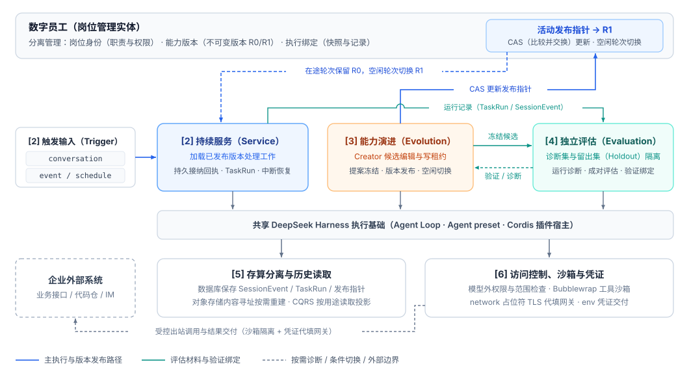
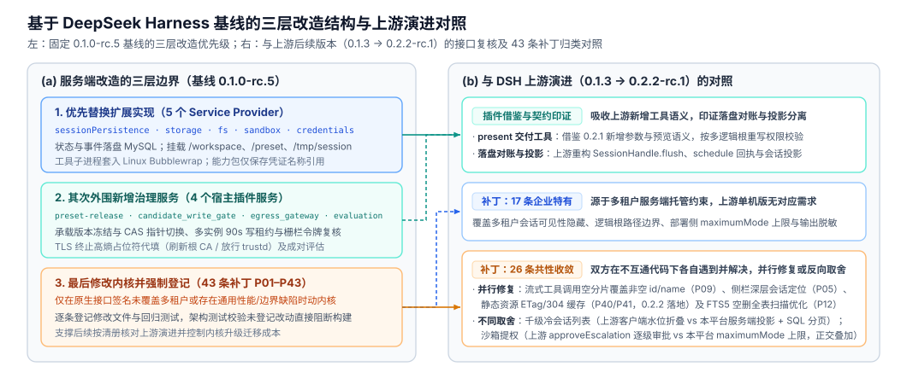

### 方出 · [fanstrue.cn](https://fanstrue.cn)

关注 **Agent 长期在线运行与托管架构（Agent Harness / Runtime）**、**自动化评测与防退化治理** 以及 **小参数模型微调与强化学习（SFT / GRPO）**。

---

### 技术文章

- **[《SEE：企业数字员工的持续服务与能力演进——基于 DeepSeek Harness 的服务端托管与治理探索》](https://fanstrue.cn/article/service-evolution-evaluation/)**
  - **持续服务（Service）**：多源触发（`conversation` / `event` / `schedule`）确定性 Fast Path 准入、待确认回执（Pending Receipt）经 `SessionEvent` 落盘对账激活、`TaskRun` 序号区间索引与容器中断后的文件断点自动续跑。
  - **能力演进（Evolution）**：复用 `Agent preset` 与 `Cordis` 装配机制，通过带 90s TTL 与 UUID 栅栏令牌（Fencing Token）的候选写租约、提案冻结、活动发布指针 CAS 切换与空闲轮次切换隔离日常服务与能力修改。
  - **独立评估（Evaluation）**：诊断集与留出集（Holdout）输入/判分双树隔离，基于逐题成对评估（Paired Evaluation）与验证绑定拦截局部能力退化。
  - **存算分离与安全边界**：SHA-256 内容寻址对象存储按需重建工作目录（跨版本引用复用比 18.8×）、CQRS 历史读取投影（剥离 95.4% `assistant/chunk` 流式分片）、模型外权限检查、Linux `Bubblewrap` 沙箱与 TLS 终止高熵占位符代填网关。

  

  

---

### 开源社区反馈（`deepseek-ai/deepseek-harness`）

- **[Discussion #12188](https://github.com/deepseek-ai/deepseek-harness/discussions/12188)**：`dsh-session-query-sqlite` 冷建 FTS5 `UNINDEXED` 列空删全表扫描、`_observeStable` 并发新建会话打断观察窗口与 `_globalGeneration` 流式写入使翻页游标失效的定位与改进建议（核对至 `0.2.2-rc.1`）。
